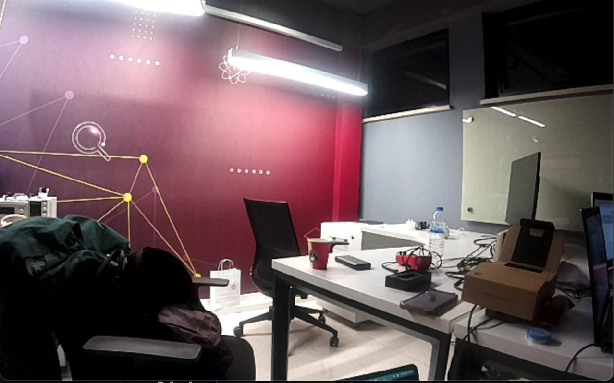
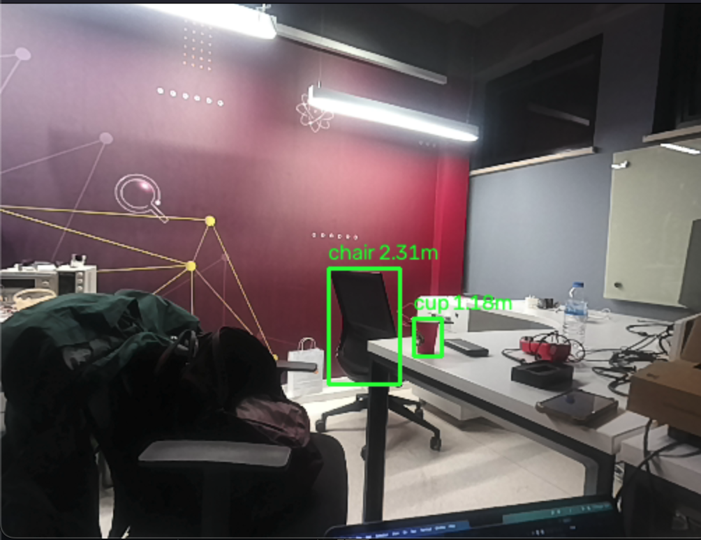

# OAK-D Kamera Testi

Projenin bulunduğu klasörde terminal açarak aşağıdaki komutları çalıştırabilirsiniz.

## Gerekli kütüphanelerin kurulumu

```
pip install -r requirements.txt
```

## Cihaz bağlı mı kontrolü

```
python main.py --list-devices
```

## Sadece kamerayı açma

```
python main.py --mode preview --show
```



## AI derinlik (detect) modu ile kamerayı açma

```
python main.py --mode detect --show
```



Önizleme penceresinden çıkmak için `q` tuşuna basın.
